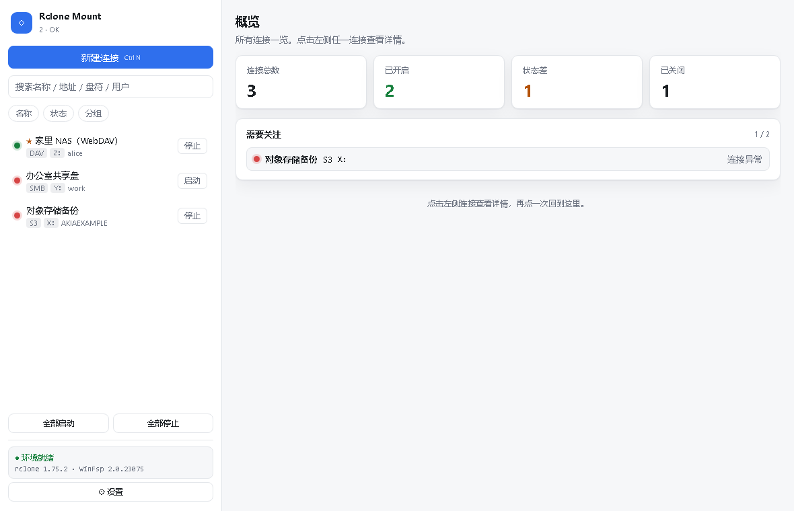
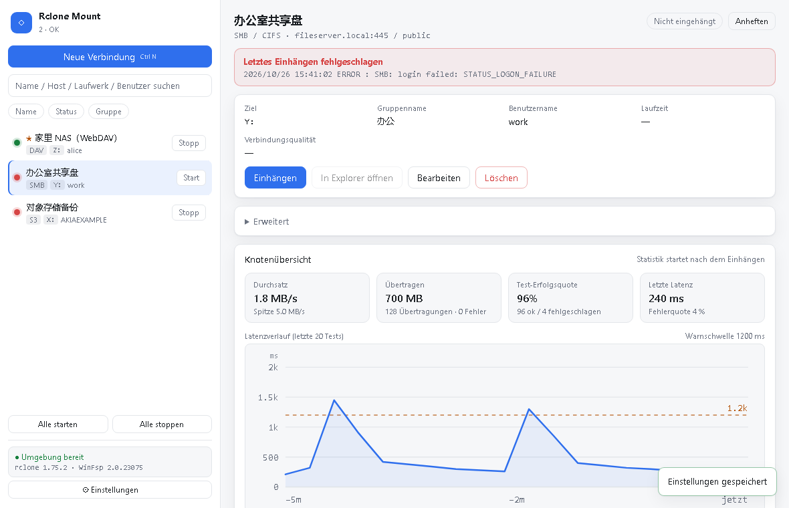
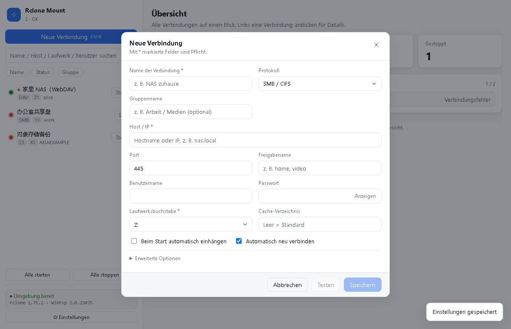
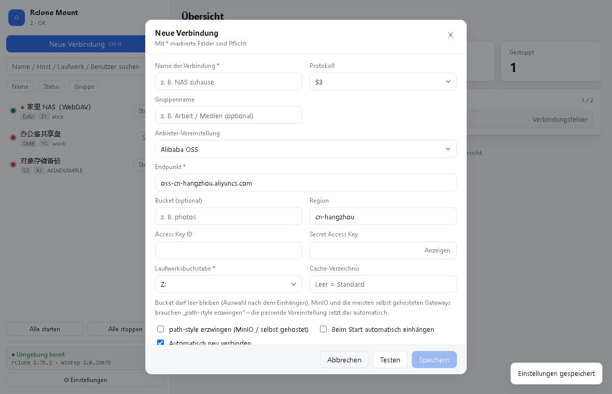
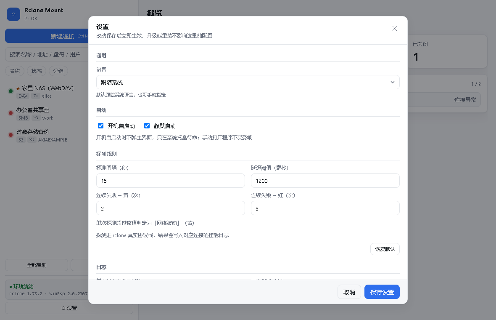
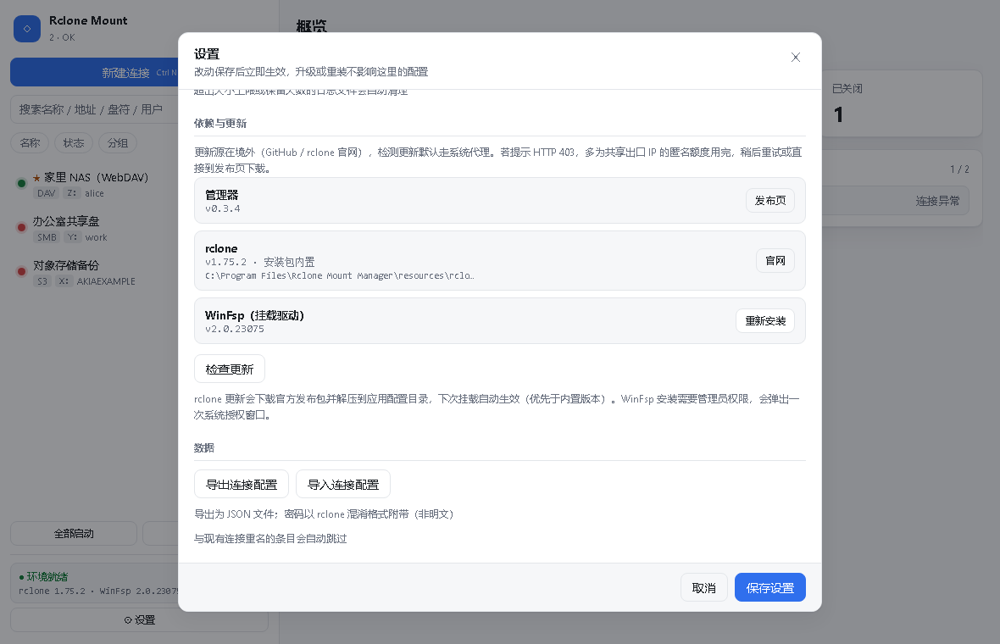
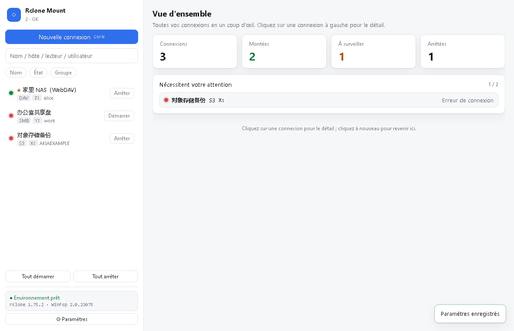
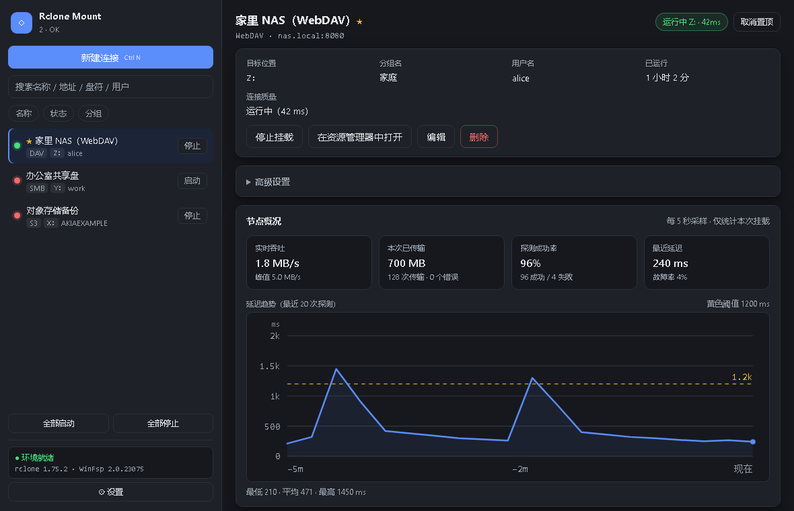

# Rclone Mount Manager

把 NAS / 网络存储 / 对象存储挂成本地盘符的跨平台桌面工具，基于 [rclone](https://rclone.org) 与平台原生 FUSE 驱动。
**没有账号、没有登录、没有广告、不联网验证**——打开就用，断网也能用。

> A cross-platform desktop GUI that mounts SMB / WebDAV / FTP / SFTP / S3 as local drives.
> Powered by rclone + WinFsp / macFUSE / fuse3. No account, no sign-in, no ads, fully offline.

[](https://github.com/Jie-baobao/rclone-mount-manager/actions/workflows/build.yml)
[](https://github.com/Jie-baobao/rclone-mount-manager/releases)
[](LICENSE)




---

## 为什么做这个

同类工具各有各的坑：

| 工具 | 问题 |
|---|---|
| **RaiDrive** | 强制登录账号，服务器在境外，网络受限时连界面都进不去 |
| **Mountain Duck** | 好用，但 $39 起 |
| **Windows 自带 WebDAV 映射** | 单文件 50MB 限制、非标准端口支持差、断线直接卡死资源管理器 |
| **rclone 本身** | 能力最强，但纯命令行，改个连接要背一串参数 |

这个项目做的事很简单：把 rclone 的能力包一层好用的界面，把依赖一起打进安装包，同时把这些坑都填掉。

## 功能

### 挂载

- **五种后端**：SMB / CIFS、WebDAV、FTP、SFTP、**S3 兼容对象存储**
- S3 兼容族内置服务商预设：Amazon S3、阿里云 OSS、腾讯云 COS、Cloudflare R2、Backblaze B2、Wasabi、DigitalOcean Spaces、MinIO / 自建
- 挂成真实盘符（Windows `Z:`）或挂载点（`/mnt/nas`）
- **本地磁盘 / 网络驱动器**两种形态（Windows）
- **只读挂载**：给「只看不改」的资料库上把锁
- **启动时自动挂载**：常用连接开机即挂
- **断线自动重连**：后台看护线程，指数退避重试（最多 5 次），并记录重连次数
- **列表行内启停**：不用点进详情，每行右侧直接「启动 / 停止」
- **全部启动 / 全部停止**：一键批量操作，托盘菜单也能触发
- **分组**：新建时填个组名，组名会做进卷标（`[工作] NAS (Z:)`），资源管理器按名称排序时同组磁盘自然相邻；管理器内「按分组」排序时每组上方压一行组名标题
- **排序**：搜索栏下方三个 chip（名称 / 状态 / 分组），点一下正序 ↑、再点倒序 ↓、第三下回到默认的添加顺序；只有选中的那项变色并带箭头。名称按中文拼音排（`NAS2` 在 `NAS10` 前），状态按 绿 → 黄 → 红 → 灰，分组按组名 A-Z 且组内也 A-Z、未分组垫底。**排序状态记在 `settings.json`，下次开机保持**
- **代理**：每条连接可勾「走系统代理」（默认不勾）；手动填的代理地址优先级更高，挂载与探测用同一套代理、回环地址自动排除
- **探测方式可配**：轻量（只测端口连通，**不碰盘、不唤醒休眠硬盘**，默认）/ 完整（真实列目录，能发现文件层异常但会唤醒硬盘）/ 仅进程（零流量，只看挂载进程是否存活）

### 状态一眼看清

列表每个连接前面有个状态圆点，四种颜色对应四种状态：

| 颜色 | 含义 |
|---|---|
| 🟢 绿 | 已挂载，探测正常 |
| 🟡 黄 | 已挂载，但延迟偏高 / 网络波动 / 探测超时 |
| 🔴 红 | 进程退出、认证失败、连续探测失败，当前不可用 |
| ⚪ 灰 | 已停止 |

黄色不是猜的：后台按设定间隔对已挂载连接跑一次探测，默认每 15 秒一次，
**单次往返超过 1200ms、或连续 2 次超时变黄，连续 3 次失败变红**。
这三组阈值和探测间隔都能在「设置 → 探测规则」里改，也可以一键恢复推荐值。探测结果会写进对应连接的挂载日志。

探测方式默认是**轻量**：只对 `主机:端口` 做一次 TCP 握手，不读任何目录，因此**不会把休眠中的 NAS 硬盘唤醒**。
需要「服务活着但文件层坏了」这种更细的信号时，可以在连接的高级选项里改成**完整**（`rclone lsd --max-depth 1`，
真实列一次根目录，代价是会碰盘）；只关心挂载进程有没有掉线的话选**仅进程**（一个包都不发）。

### 首页概览

打开软件默认**不选中任何连接**，右侧就是概览：连接总数、已开启、状态差、已关闭四个数字，
下面把「状态差」（黄色 / 红色）的连接单独列出来，点一下直接进它的详情。

列表里点一条连接进详情，**再点同一条就回到概览**；点连接栏的空白处、或者窗口里没有内容的空白区域也一样。
点日志区、卡片、图表这些「有内容的地方」不会触发返回，不会误跳。


### 分组与资源管理器

分组名会写进挂载卷标：填了「工作」的连接会显示成 **`[工作] NAS (Z:)`**。
这样在资源管理器里按「名称」排序时，同组的盘天然挨在一起，不需要任何额外的分组插件。

- Windows / macOS 走 rclone 的 `--volname`，卷标上限 32 字符，建议组名短一点
- Linux 的 rclone 不支持 `--volname`，只显示挂载点目录名
- 资源管理器「此电脑」是虚拟文件夹，系统强制套预设视图模板，「分组依据」没有自定义字段，
  也没有公开 API 能给盘符标组——所以这里用卷标前缀这个折中办法
- 卷名在挂载那一刻定死：**改组名 / 改名称后要重新挂载**才会刷新（保存连接会自动重连，不用手动操作）

### 节点概况：这次挂载到底怎么样

详情页在日志上方有一块「节点概况」，数据来自挂载进程自带的本机 rc 端口（只监听 `127.0.0.1`），
每 5 秒采样一次、只存在内存里，不写盘也不额外开网络会话：

- **实时吞吐 / 峰值吞吐**（读写合计）
- **本次已传输**（总量 / 传输次数 / 错误数）
- **探测成功率与故障率**（成功、失败次数）
- **延迟趋势图**：只画最近 20 次探测（窗口固定，跑一整天也不会变重），左侧是数值刻度与横向参考线，
  黄色虚线是波动阈值，失败的那次在基线上标红点，下面补一行「最低 / 平均 / 最高」；
  X 轴按探测间隔换算成真实时间（如 `−5m / −2m / 现在`），采样再久也只画最近这一段。

> 吞吐是读写合计——rclone 的统计本身不区分上行/下行。要按方向拆分只能去读系统网卡计数器，
> 那会把其它程序的流量也算进来，所以没做，见路线图「待定」。

### 依赖自带，装完即用

- **rclone 内置在安装包里**，不用自己下载、不用配 PATH
- **WinFsp 驱动**（Windows 挂盘符必需）随包附带，可在「设置 → 依赖与更新」里一键安装 / 升级
- 「设置 → 依赖与更新」显示管理器、rclone、WinFsp 的当前版本与来源，可一键检查更新
- rclone 更新会解压到应用配置目录，**优先于内置版本**，升级不需要重装应用
- **升级 / 重装软件不会动配置目录**：连接、设置、日志都原样保留

### 性能与网络

- **VFS 缓存**（`--vfs-cache-mode full`）+ 可配置缓存上限，异地访问不卡
- **带宽限制**（`--bwlimit`）：走公网 / P2P 时避免占满上行
- **HTTP 代理**：支持给单个连接单独指定代理
- **自签证书**：WebDAV over HTTPS 一键放行

### 诊断与安全

- **连接测试**：WebDAV 发真实 `PROPFIND` 请求，直接区分 `401`（密码错）/ `403`（无权限）/ `404`（路径错）/ `405`（不是 WebDAV）/ `207`（正常），并显示**实际请求的 URL**
- **密码不落明文**：写入 `rclone.conf` 前先用 `rclone obscure` 处理；应用自己的配置里只存连接信息
- **显示密码开关**：肉眼核对用（下面「常见坑」里那条会救你一次）
- **挂载失败显示原始报错**：等 900ms 抓 rclone 的真实退出原因，不给「假成功」
- **配置原子写**：临时文件 + `.bak` 备份，断电/杀进程不会留下半截 JSON

挂载失败时不吞错，把 rclone 的原始报错直接摊在界面上：



### 体验

- **七语言界面**：简体中文 / 繁體中文 / English / Français / Deutsch / 日本語 / 한국어，默认跟随系统语言，可在设置里手动切换（下拉项用各自语言显示）。文案是独立的语言文件（`src/locales/*.json`），加语言不用改代码；界面文案全部走翻译表，后端返回的原文（WebDAV 诊断说明、rclone 报错、日志内容）保持原话，方便对照官方文档排查
- 跟随系统深浅色
- **统一的设置页**：通用 / 启动 / 探测规则 / 日志 / 依赖与更新 / 数据，分区标题，全部弹窗同一套样式
- **开机自启动 + 静默启动**（默认勾选）：静默时只在托盘待命，不弹主界面；手动打开程序永远显示窗口
- **托盘左键 = 打开主界面**，右键才是菜单（显示主窗口 / 全部挂载 / 全部卸载 / 退出）；关窗口 = 收进托盘
- **日志自动管理**：单个连接日志到上限自动裁剪，超过保留天数的日志自动清理
- **连接配置导入 / 导出**：换机器、重装系统都不用手动重建；密码以 rclone 混淆格式随文件带走，不是明文
- 连接置顶、搜索过滤（名称 / 地址 / 盘符 / 用户名）、`Ctrl+N` 新建、`Ctrl+R` 刷新
- 挂载日志实时刷新（挂载中每 4 秒），探测结果也在这里

<table>
<tr>
<td></td>
<td></td>
</tr>
<tr>
<td></td>
<td></td>
</tr>
<tr>
<td></td>
<td></td>
</tr>
<tr>
<td></td>
<td></td>
</tr>
</table>

## 平台支持

| | Windows | macOS | Linux |
|---|---|---|---|
| 界面 / 配置 / 日志 | ✅ | ✅ | ✅ |
| 挂载驱动 | WinFsp（随包） | macFUSE / FUSE-T | fuse3 |
| 目标形式 | 盘符 `Z:` | 挂载点 | 挂载点 |
| rclone | 内置 | 内置 | 内置 |
| 自启动 | ✅ 注册表 | ✅ LaunchAgent | ✅ .desktop |
| 托盘 | ✅ | ✅ | ✅ |
| 状态 | 已实测 | 代码就绪，待实机验证 | 代码就绪，待实机验证 |

## 安装

### 1. 安装包

从 [Releases](https://github.com/Jie-baobao/rclone-mount-manager/releases) 下载：

- Windows：`.msi` / `.exe`
- macOS：`.dmg`
- Linux：`.AppImage` / `.deb` / `.rpm`

**rclone 已内置，不需要另外安装。**

### 2. 挂载驱动

| 平台 | 说明 |
|---|---|
| Windows | 安装包里带了 WinFsp 安装程序。没装过时，打开「设置 → 依赖与更新」点「一键安装」（会弹一次管理员授权） |
| macOS | `brew install --cask macfuse`（或 `fuse-t`），首次需在「系统设置 → 隐私与安全性」里允许系统扩展 |
| Linux | `sudo apt install fuse3` / `sudo dnf install fuse3` |

程序启动时左下角会显示环境自检结果；点它打开设置页，「依赖与更新」里缺什么一眼能看到，也能直接装。

### 3. 从源码构建

需要 **Node 18+**、**Rust 1.77+**；Windows 还需要 **Microsoft C++ Build Tools**。

```bash
git clone https://github.com/Jie-baobao/rclone-mount-manager.git
cd rclone-mount-manager
npm install

# 可选：把 rclone 放进 resources，构建出的包才自带 rclone
#   下载 https://downloads.rclone.org/ 对应平台压缩包，解出 rclone(.exe)
#   放到 src-tauri/resources/rclone/

npm run tauri build       # 产物在 src-tauri/target/release/bundle/
```

开发：

```bash
npm run tauri dev         # 桌面应用热重载
npm run dev               # 只跑前端（浏览器打开，用内置模拟数据看界面）
```

界面截图 / 回归检查：

```bash
npx playwright install chromium   # 只需一次
npm run dev                       # 另开一个终端
node scripts/shot.mjs             # 输出到 docs/screenshots/
```

## 使用

1. 点「新建连接」，选协议
2. 填地址 / 端口 / 账号密码 —— 先点「测试连接」验一遍
3. 选盘符（或挂载点），保存 —— 新建的连接会**自动挂载**，不用再点一次启动
4. 资源管理器里就出现了；之后在列表里直接点「启动 / 停止」即可

## 常见坑

这些都是真实踩过的，写在最前面：

- **漏写端口**：不少 NAS 的 WebDAV 走非标准端口（如 `5005` / `5006`）。只填主机名会落到 80 端口的反向代理上，返回一段 HTML，客户端就报「XML 语法错误」之类的怪错。本工具会自动补端口，但显式填上更稳。
- **密码里的 `!` 被输入法打成全角 `！`**：屏幕上几乎看不出差别，但服务端一定返回 `401`，客户端还会无限弹密码框。用「显示」核对一次就能发现。
- **自签证书**：HTTPS 的 WebDAV 如果是自签证书，必须勾「忽略证书校验」。
- **SMB 共享名不能省**：`\\NAS\share` 里的 `share` 是必填的，只填 IP 挂不上。
- **S3 与服务商不匹配**：MinIO 和多数自建网关要勾「强制 path-style」，选对应预设会自动设置；区域填错会报签名错误。
- **Windows 上盘符冲突**：选一个没被占用的盘符。

## 工作原理

```
┌─────────────────────────────┐
│  前端  React + TypeScript   │  连接列表 / 向导 / 日志 / 版本面板
└──────────────┬──────────────┘
               │ Tauri IPC（命令 + 事件）
┌──────────────▼──────────────┐
│  后端  Rust                 │
│  ├ store.rs    配置读写（原子写 + .bak）        │
│  ├ rclone.rs   conf 生成 / obscure / 挂载参数   │
│  ├ diag.rs     PROPFIND 诊断 / 驱动检测         │
│  ├ update.rs   版本检查 / 下载安装 rclone 与驱动 │
│  ├ settings.rs 设置持久化（语言 / 探测 / 日志）   │
│  └ autostart.rs 三平台自启动（带 --silent）      │
└──────────────┬──────────────┘
               │ 子进程
        ┌──────▼──────┐
        │   rclone    │ ← WinFsp / macFUSE / fuse3
        └─────────────┘
```

- 每个连接对应一个 `rclone mount` 子进程，句柄由后端持有
- 后台看护线程每 5 秒检查一次存活，意外退出按 `2s → 5s → 8s → 11s → 14s` 退避重连
- 健康探测线程按设置里的间隔（默认 15 秒）对已挂载连接做一次轻量请求，得出绿 / 黄 / 红，并把结果写进该连接的日志
- 每小时巡检一次日志目录，按「上限大小 / 保留天数」自动裁剪与清理
- 状态变化通过 Tauri 事件推给前端，另有 8 秒兜底轮询
- 关闭窗口 = 收进托盘；从托盘「退出」才会停掉所有挂载

## 配置文件位置

| 平台 | 路径 |
|---|---|
| Windows | `%APPDATA%\io.github.rclonemount.manager\` |
| macOS | `~/Library/Application Support/io.github.rclonemount.manager/` |
| Linux | `~/.config/io.github.rclonemount.manager/` |

- `connections.json` — 连接列表（不含密码）
- `settings.json` — 设置（语言 / 静默启动 / 探测规则 / 日志策略）
- `rclone.conf` — rclone 远程配置（密码已 obscure）
- `bin/rclone(.exe)` — 手动更新过的 rclone（优先于内置版本）
- `logs/mount-<id>.log` — 每个连接的挂载日志（含健康探测记录）

升级安装包只会覆盖程序本体，不会碰这个目录；卸载时也默认保留。

## 路线图

- [x] 随包附带 rclone 二进制，免手动安装
- [x] S3 兼容对象存储
- [x] 多语言（简体中文 / 繁體中文 / English / Français / Deutsch / 日本語 / 한국어）
- [x] 连接配置导入 / 导出
- [x] 设置页（探测规则、日志策略、依赖更新、启动行为）
- [ ] 更多云盘后端（Google Drive / OneDrive / Dropbox，需要 OAuth 授权流程）
- [ ] macOS / Linux 实机验证与打包签名
- [ ] 系统文件管理器右键菜单集成
- [x] 详情页节点概况（实时吞吐、峰值、传输量、成功率、带 Y 轴的延迟趋势图）
- [x] 首页概览（总数 / 已开启 / 状态差 / 已关闭 + 需关注列表）
- [x] 分组（卷标前缀）与排序（名称 / 状态 / 分组三态，记忆到下次开机）
- [x] 连接级系统代理开关、可配探测方式（轻量默认 / 完整 / 仅进程）
- [x] 更新检测走系统代理，版本号改用重定向读取（不消耗 GitHub API 匿名额度）
- [ ] 上行 / 下行分开的流量统计与按天汇总（**待定**：rclone 统计不区分方向，
      要拆分只能读系统网卡计数器，会把其它程序流量算进来，先不做）

## 新增一种语言（只改语言文件，不动代码）

界面文案全部放在 `src/locales/`，一种语言一个 JSON，清单文件 `languages.json` 指定内置哪几种、
以及每种语言的文件路径：

```jsonc
// src/locales/languages.json
{
  "fallback": "zh-CN",                                  // 缺 key 时回退到哪种语言
  "languages": [
    { "code": "zh-CN", "native": "简体中文", "file": "./zh-CN.json" },
    { "code": "zh-TW", "native": "繁體中文", "file": "./zh-TW.json" },
    { "code": "en",    "native": "English",  "file": "./en.json"  }
    // 加一行就是加一种语言，顺序就是设置页下拉框的顺序
  ]
}
```

加一种语言就两步：

1. 复制 `src/locales/en.json` → `src/locales/pt-BR.json`，把值翻译掉（键名不要动，占位符如 `{v}`、`{name}` 保持原样）；
2. 在 `languages.json` 的 `languages` 里加一行 `{ "code": "pt-BR", "native": "Português (Brasil)", "file": "./pt-BR.json" }`。

重新构建后设置页下拉框里就有它，`system`（跟随系统语言）也会按 `navigator.language` 自动匹配到它
（`pt-BR` / `pt-PT` 都能命中 `pt-BR`；中文会额外区分简繁）。

几个设计取舍：

- **构建时打包，不读磁盘**：`src/i18n.ts` 用 `import.meta.glob` 把 `locales/*.json` 全部编译进前端资源，
  发布出去的安装包自带所有语言，运行时不依赖任何外部文件，也就不会因为文件丢了白屏。
- **清单写错不会炸**：声明了但文件不存在，只跳过这一项并在控制台告警，其余语言照常工作；`fallback`
  写了不存在的代码就退化成清单第一项。
- **改完记得自检**：`npm run i18n:check`（`npm run build` 也会先跑）会以回退语言为基准检查每个文件的
  缺键 / 多键 / 空值 / 占位符不一致，任何一项不过就直接失败。

## 贡献

欢迎 Issue 和 PR。提交前请确保：

```bash
npm run i18n:check                   # 语言文件完整性（缺键 / 多键 / 占位符）
npm run build                        # 前端类型检查 + 构建
cd src-tauri && cargo fmt --check    # Rust 格式
cd src-tauri && cargo check          # Rust 编译检查
```

## 许可

[MIT](LICENSE)。

rclone 同为 MIT；WinFsp 为 GPLv3（作为独立驱动安装，不修改其源码）；macFUSE / FUSE-T 各自遵循其许可。

本项目与 rclone、WinFsp、RaiDrive、Mountain Duck 均无隶属关系，仅使用公开协议与公开 API 的独立实现。
